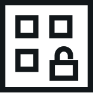
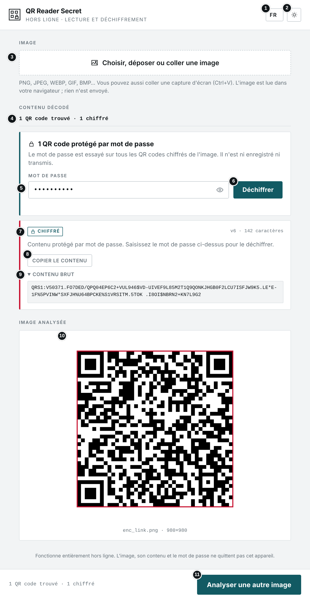
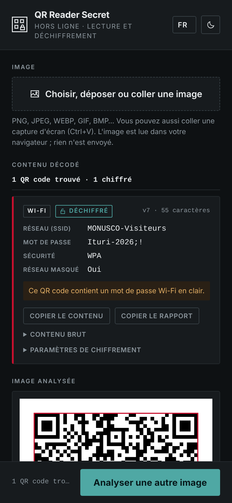
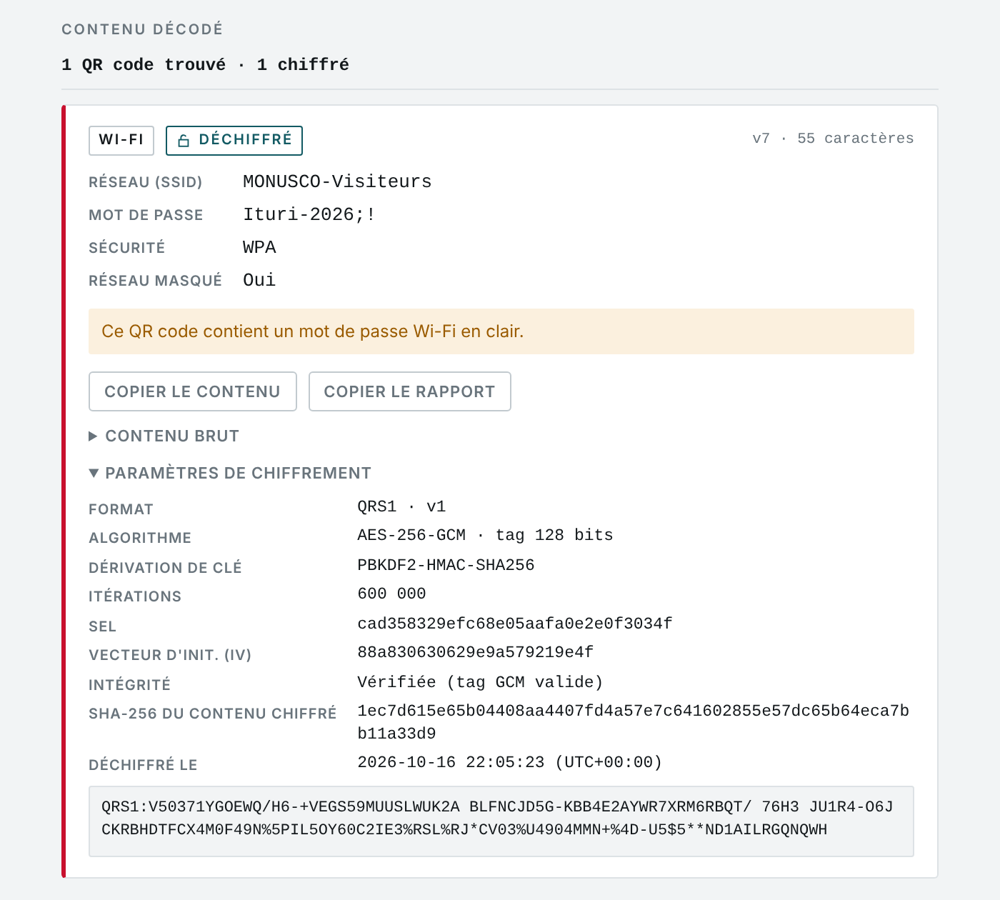
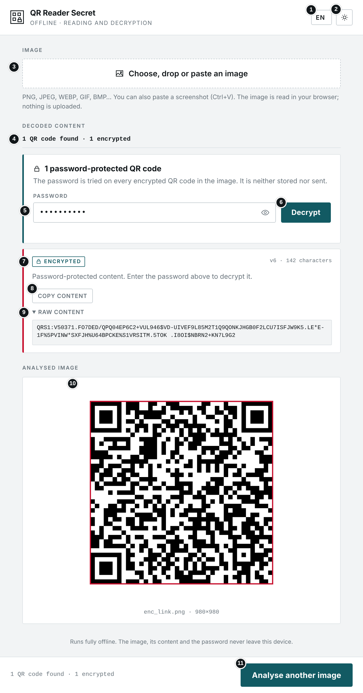
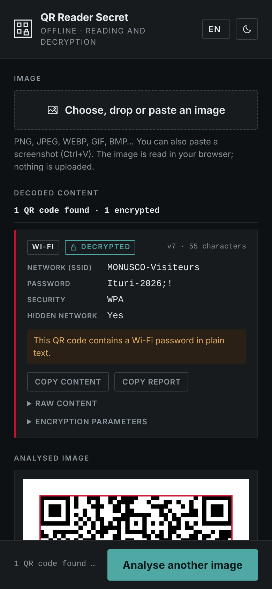
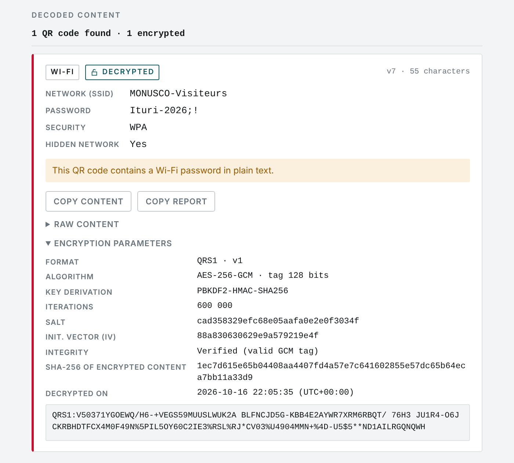

# QR Reader Secret

**`QR_READER_SECRET.html`** · Hors ligne · Aucune installation · Aucun envoi · Déchiffrement par mot de passe — *Offline · No install · No upload · Password decryption*

**[Français](#français) · [English](#english)**

📘 Manuel d'utilisation / User manual (FR) : [PDF](Manuel_QR_READER_SECRET.pdf) · [Word](Manuel_QR_READER_SECRET.docx)

---

## Français

### À quoi sert cet outil

Cet outil lit les QR codes contenus dans une image (photo, capture d'écran, document numérisé) et affiche leur contenu en clair : lien, texte, adresse, identifiants Wi-Fi, e-mail, numéro de téléphone, SMS, position GPS, carte de contact ou événement. Il **déchiffre en plus les QR codes protégés par mot de passe** créés avec [QR Generator Secret](https://github.com/FOSS4DF/QR_GENERATOR_SECRET).

### Avant de commencer

- Ouvrez le fichier QR_READER_SECRET.html par double-clic : il s'affiche dans votre navigateur (Chrome, Edge, Firefox ou Safari récents). Aucune installation n'est nécessaire.
- L'outil fonctionne sans connexion Internet. Aucun fichier n'est envoyé : tout le traitement, déchiffrement compris, se fait sur votre appareil. Seule l'ouverture d'un lien ou de Google Maps nécessite Internet.
- La langue (FR, EN, SW, LN) se choisit en haut à droite ; le bouton voisin bascule entre thème clair et sombre. Ces choix sont mémorisés. Le mot de passe, lui, n'est jamais enregistré.
- Les QR codes ordinaires se lisent exactement comme avec QR Reader.

### L'écran en un coup d'œil



1. Langue de l'interface
2. Thème clair ou sombre
3. Choisir, déposer ou coller (Ctrl+V) une image
4. Nombre de QR codes trouvés, dont chiffrés
5. Mot de passe ; l'œil affiche ou masque la saisie
6. Déchiffrer (essaie le mot de passe sur tous les QR codes chiffrés)
7. QR code chiffré, encore fermé (étiquette « Chiffré »)
8. Copier le contenu
9. Contenu brut : texte exact du QR code (« QRS1:… » s'il est chiffré)
10. Image analysée, QR code encadré
11. Analyser une autre image

#### Sur téléphone (thème sombre)



### Utilisation pas à pas

1. Cliquez sur « Choisir, déposer ou coller une image », faites glisser l'image sur la page, ou collez une capture d'écran avec Ctrl+V. Sur téléphone, le bouton permet aussi de prendre une photo.
2. Le décodage est immédiat. Un QR code ordinaire s'affiche directement sous forme de fiche. Un QR code protégé porte l'étiquette « Chiffré », et un cadre « QR code protégé par mot de passe » apparaît au-dessus.
3. Saisissez le mot de passe, puis cliquez sur « Déchiffrer » ou appuyez sur Entrée. Il est essayé sur tous les QR codes chiffrés de l'image.
4. La fiche affiche alors le contenu en clair, avec l'étiquette « Déchiffré ». Si certains QR codes restent fermés, ils demandent un autre mot de passe : saisissez-le et recommencez.
5. Lisez les avertissements éventuels, puis copiez le contenu ou ouvrez le lien après l'avoir vérifié.
6. Dépliez « Contenu brut » pour voir le texte exact, et « Paramètres de chiffrement » pour les détails techniques. « Copier le rapport » copie l'ensemble (paramètres, contenu chiffré et déchiffré, date).
7. Si l'image contient plusieurs QR codes, chacun est numéroté sur l'image et décrit dans sa propre fiche.

#### Contenus reconnus

| Type | Informations affichées |
|---|---|
| **Lien** | Domaine, adresse complète, bouton « Ouvrir le lien ». |
| **Texte / adresse** | Le texte complet. |
| **Wi-Fi** | Nom du réseau, mot de passe, sécurité, réseau masqué. |
| **E-mail** | Destinataire, objet, message. |
| **Téléphone / SMS** | Numéro et, pour un SMS, le message. |
| **Position GPS** | Latitude, longitude, bouton Google Maps. |
| **Contact** | Nom, organisation, fonction, téléphone, e-mail, adresse. |
| **Événement** | Titre, début, fin, lieu. |
| **QR code chiffré** | Étiquette « Chiffré » et contenu brut ; après déchiffrement, la fiche du type d'origine et l'étiquette « Déchiffré ». |

#### Paramètres de chiffrement affichés

| Paramètre | Signification |
|---|---|
| **Format** | QRS1, version 1. |
| **Algorithme** | AES-256-GCM, tag d'authentification de 128 bits. |
| **Dérivation de clé** | PBKDF2-HMAC-SHA256 et nombre d'itérations (600 000). |
| **Sel / IV** | Valeurs aléatoires propres à ce QR code (hexadécimal). |
| **Intégrité** | « Vérifiée » : le contenu n'a pas été modifié depuis sa création. |
| **SHA-256 du contenu chiffré** | Empreinte du texte exact lu dans le QR code. |
| **Déchiffré le** | Date, heure et fuseau horaire de l'appareil. |

### Fichier de test

`QR_Test.png` est un QR code chiffré. Mot de passe : **`FOSS4DF-Test-2026`**

### Résultat



*Exemple Wi-Fi après déchiffrement : contenu en clair, étiquette « Déchiffré » et paramètres de chiffrement.*

### Bonnes pratiques

- N'ouvrez jamais un lien sans avoir vérifié son domaine : un QR code, même chiffré, peut mener vers un site frauduleux.
- Le contenu déchiffré est sensible : ne laissez pas l'écran sans surveillance et rechargez la page pour l'effacer.
- Obtenez le mot de passe par un canal séparé du QR code, auprès d'une personne de confiance.
- Pour une pièce de procédure, utilisez « Copier le rapport » et conservez l'image d'origine avec son empreinte (Forensic Hash Calculator).
- Pour une photo difficile à lire, recadrez autour du QR code et évitez reflets et flou.

### En cas de problème

| Problème | Solution |
|---|---|
| **« Mot de passe incorrect, ou QR code modifié »** | Vérifiez les majuscules, les accents, les espaces et la disposition du clavier. Si le mot de passe est sûr, le QR code a pu être altéré : reprenez une image plus nette ou demandez l'original. |
| **« QR code chiffré illisible »** | Le texte commence par « QRS1: » mais il est incomplet ou endommagé. |
| **« Version de chiffrement non prise en charge »** | Le QR code a été créé par une version plus récente : mettez à jour QR Reader Secret. |
| **« Le déchiffrement n'est pas disponible… »** | Navigateur trop ancien, ou page ouverte en http : ouvrez le fichier directement (double-clic) ou via https. |
| **« Aucun QR code détecté »** | Image floue, code trop petit ou abîmé. Recadrez autour du code ou reprenez une photo plus nette. |
| **« Ce fichier n'est pas une image lisible »** | Format non reconnu par le navigateur. Les photos HEIC d'iPhone doivent être converties en JPEG. |
| **« Ouvrir le lien » ne fait rien** | Pas de connexion Internet, ou fenêtre bloquée par le navigateur. |
| **Un code-barres classique n'est pas lu** | L'outil lit uniquement les QR codes, pas les codes EAN, Data Matrix, etc. |

### Confidentialité

L'outil fonctionne entièrement sur votre appareil, sans connexion Internet. Aucune donnée n'est transmise ni conservée. Le mot de passe n'est utilisé que pendant le déchiffrement ; le champ est vidé dès que tous les QR codes sont ouverts.

### Spécification technique (format QRS1)

```
QR code (mode alphanumérique) = "QRS1:" + Base45( en-tête ‖ sel ‖ IV ‖ chiffré ‖ tag )
  en-tête   5 o  : version (0x01) ‖ itérations PBKDF2 (uint32, big-endian)
  sel      16 o  : aléatoire
  IV       12 o  : aléatoire
  chiffré   n o  : AES-256-GCM du contenu encodé en UTF-8
  tag      16 o  : tag d'authentification GCM (128 bits)
  clé      = PBKDF2-HMAC-SHA256( NFC(mot de passe), sel, itérations ) → 256 bits
  AAD      = "QRS1" ‖ en-tête
```

Le lecteur refuse une version inconnue et un nombre d'itérations hors de l'intervalle 10 000 – 2 000 000, ce qui évite qu'un QR code piégé bloque le navigateur.

---

## English

### What this tool is for

This tool reads the QR codes contained in an image (photo, screenshot, scanned document) and shows their content in plain form: link, text, address, Wi-Fi credentials, e-mail, phone number, text message, GPS location, contact card or event. It also **decrypts password-protected QR codes** created with [QR Generator Secret](https://github.com/FOSS4DF/QR_GENERATOR_SECRET).

### Before you start

- Double-click QR_READER_SECRET.html: it opens in your browser (recent Chrome, Edge, Firefox or Safari). Nothing to install.
- The tool works without an Internet connection. No file is uploaded: everything, including decryption, is processed on your device. Only opening a link or Google Maps needs Internet.
- Choose the language (FR, EN, SW, LN) at the top right; the button next to it switches between light and dark theme. Both choices are remembered. The password never is.
- Ordinary QR codes are read exactly as in QR Reader.

### The screen at a glance



1. Interface language
2. Light or dark theme
3. Choose, drop or paste (Ctrl+V) an image
4. Number of QR codes found, and how many are encrypted
5. Password; the eye shows or hides what you type
6. Decrypt (tries the password on every encrypted QR code)
7. Encrypted QR code, still locked (“Encrypted” label)
8. Copy the content
9. Raw content: exact text of the QR code (“QRS1:…” if encrypted)
10. Analysed image, QR code outlined
11. Analyse another image

#### On a phone (dark theme)



### Step by step

1. Click “Choose, drop or paste an image”, drag the image onto the page, or paste a screenshot with Ctrl+V. On a phone, the button can also take a photo.
2. Decoding is immediate. An ordinary QR code appears straight away as a card. A protected QR code carries the “Encrypted” label, and a “Password-protected QR code” box appears above it.
3. Type the password, then click “Decrypt” or press Enter. It is tried on every encrypted QR code in the image.
4. The card now shows the plain content, with the “Decrypted” label. If some QR codes stay locked, they need a different password: type it and try again.
5. Read any warnings, then copy the content or open the link once you have checked it.
6. Expand “Raw content” to see the exact text, and “Encryption parameters” for the technical details. “Copy report” copies everything (parameters, encrypted and decrypted content, date).
7. If the image contains several QR codes, each one is numbered on the image and described in its own card.

#### Recognised content

| Type | Information shown |
|---|---|
| **Link** | Domain, full address, “Open link” button. |
| **Text / address** | The full text. |
| **Wi-Fi** | Network name, password, security, hidden network. |
| **Email** | Recipient, subject, message. |
| **Phone / SMS** | Number and, for an SMS, the message. |
| **GPS location** | Latitude, longitude, Google Maps button. |
| **Contact** | Name, organisation, position, phone, e-mail, address. |
| **Event** | Title, start, end, location. |
| **Encrypted QR code** | “Encrypted” label and raw content; once decrypted, the card for the original type and the “Decrypted” label. |

#### Encryption parameters shown

| Parameter | Meaning |
|---|---|
| **Format** | QRS1, version 1. |
| **Algorithm** | AES-256-GCM, 128-bit authentication tag. |
| **Key derivation** | PBKDF2-HMAC-SHA256 and iteration count (600,000). |
| **Salt / IV** | Random values specific to this QR code (hexadecimal). |
| **Integrity** | “Verified”: the content has not been changed since it was created. |
| **SHA-256 of encrypted content** | Hash of the exact text read from the QR code. |
| **Decrypted on** | Date, time and time zone of the device. |

### Test file

`QR_Test.png` is an encrypted QR code. Password: **`FOSS4DF-Test-2026`**

### Result



*Wi-Fi example after decryption: plain content, “Decrypted” label and encryption parameters.*

### Good practice

- Never open a link without checking its domain: a QR code, even an encrypted one, can lead to a fraudulent site.
- Decrypted content is sensitive: don't leave the screen unattended, and reload the page to clear it.
- Get the password through a channel separate from the QR code, from someone you trust.
- For case evidence, use “Copy report” and keep the original image with its hash (Forensic Hash Calculator).
- For a photo that is hard to read, crop around the QR code and avoid glare and blur.

### Troubleshooting

| Problem | Solution |
|---|---|
| **“Wrong password, or the QR code has been altered”** | Check capitals, accents, spaces and the keyboard layout. If you are sure of the password, the QR code may have been altered: take a sharper image or ask for the original. |
| **“Unreadable encrypted QR code”** | The text starts with “QRS1:” but is incomplete or damaged. |
| **“Unsupported encryption version”** | The QR code was made by a newer version: update QR Reader Secret. |
| **“Decryption isn't available…”** | Outdated browser, or page opened over http: open the file directly (double-click) or over https. |
| **“No QR code detected”** | Blurry image, code too small or damaged. Crop around the code or take a sharper photo. |
| **“This file is not an image the browser can read”** | Format not recognised by the browser. iPhone HEIC photos must be converted to JPEG. |
| **“Open link” does nothing** | No Internet connection, or the window is blocked by the browser. |
| **A regular barcode is not read** | The tool only reads QR codes, not EAN, Data Matrix or other codes. |

### Privacy

The tool runs entirely on your device, without an Internet connection. No data is sent or kept. The password is only used during decryption; the field is cleared as soon as every QR code is open.

### Technical specification (QRS1 format)

```
QR code (alphanumeric mode) = "QRS1:" + Base45( header ‖ salt ‖ IV ‖ ciphertext ‖ tag )
  header     5 B : version (0x01) ‖ PBKDF2 iterations (uint32, big-endian)
  salt      16 B : random
  IV        12 B : random
  ciphertext n B : AES-256-GCM of the UTF-8 content
  tag       16 B : GCM authentication tag (128 bits)
  key       = PBKDF2-HMAC-SHA256( NFC(password), salt, iterations ) → 256 bits
  AAD       = "QRS1" ‖ header
```

The reader rejects an unknown version and an iteration count outside 10,000 – 2,000,000, so a booby-trapped QR code cannot freeze the browser.

---

*Bibliothèque intégrée / Embedded library: jsQR 1.4.0 (Apache 2.0). Déchiffrement / Decryption: Web Crypto API.*
